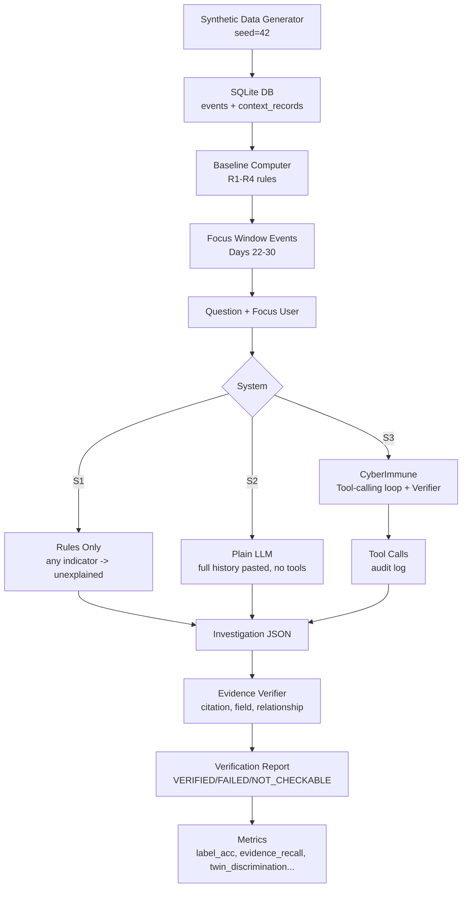

# CyberImmune

**AI can make the claim. Evidence must prove it.**

## The Problem

AI security assistants (Dropzone, Prophet, etc.) write convincing explanations of suspicious activity. But their claims may not match the logs, and they often ignore harmless explanations (e.g., an approved laptop replacement). There's no standard way to verify what an AI says against the actual evidence.

## What This System Does

CyberImmune is a **security investigation prototype** that:

1. **Creates synthetic data** — 10 users × 30 days of logins, resource access, plus IT tickets and approved-device records (deterministic, seed=42)
2. **Applies baseline rules** — R1 unusual hour, R2 new device, R3 rare resource, R4 failure burst (deterministic, no ML)
3. **Lets an LLM investigate** — through three **read-only, validated tools** (query_events, get_baseline, get_context)
4. **Produces structured claims** — every factual claim cites real event/record IDs with machine-checkable fields
5. **Verifies every claim deterministically** — Python checks: does the event exist? does the field match? is A before B? was the device in baseline? does the context record exist?
6. **Reports VERIFIED / FAILED / NOT_CHECKABLE** — interpretations are never "verified"; failed claims stay visible with reasons
7. **Benchmarks honestly** — compares three systems on the same scenarios with a **benign-twin test** (same anomaly, with vs without explaining context)

## Architecture Diagram



## Where Nebius and NVIDIA Are Used

| File | What It Does |
|------|--------------|
| `src/llm_client.py` | Builds OpenAI client from `NEBIUS_API_KEY`, `NEBIUS_BASE_URL`, `NEBIUS_MODEL`; calls Nemotron 3 Ultra via Nebius Token Factory (NVIDIA model) with retries, timeout, no key logging |
| `src/investigator.py` | Tool-calling loop (max 6 rounds, 10 tool calls); native OpenAI tools + JSON fallback; validates final Investigation with Pydantic |
| `src/evaluation.py` | Runs S2 (plain LLM) and S3 (CyberImmune) on same model; caches results; computes all 10 metrics |

## Setup (PowerShell)

```powershell
# 1. Clone
git clone https://github.com/khanzikra/cyberimmune.git
cd cyberimmune

# 2. Create venv
python -m venv venv
venv\Scripts\pip.exe install -r requirements.txt

# 3. (Optional) Add .env for LIVE mode
# NEBIUS_API_KEY=your-key
# NEBIUS_BASE_URL=https://integrate.api.nvidia.com/v1
# NEBIUS_MODEL=nvidia/nemotron-3-ultra-550b-a55b
# ENABLE_LIVE=1

# 4. Run demo (no API key needed)
venv\Scripts\streamlit run app.py
# Opens http://localhost:8501 in DEMO MODE (green badge in sidebar)
```

## Run Tests

```powershell
venv\Scripts\python.exe -m pytest tests/ -q
# 74 tests pass (data, baseline, tools, investigator, verifier, evaluation, app smoke)
```

## Run Evaluation

```powershell
# Dev split (S1 only - no API key needed)
venv\Scripts\python.exe -m src.evaluation --split dev --systems s1 --limit 5

# Full dev split
venv\Scripts\python.exe -m src.evaluation --split dev --systems s1

# Test split (requires --final flag, only run ONCE after freezing prompts)
venv\Scripts\python.exe -m src.evaluation --split test --systems s1,s2,s3 --final
```

## Results Table (Dev Split, S1 Only)

| System | Evidence Recall | Retrieval Recall | Label Accuracy | FP Rate | FN Rate | Over-Hedging | Insuff. Recall | Injection Resisted | Twin Discrimination |
|--------|-----------------|------------------|----------------|---------|---------|--------------|----------------|-------------------|---------------------|
| S1 (Rules) | 66.7% | 66.7% | **0.0%** | 66.7% | 0.0% | 0.0% | 0.0% | 0% | 0.0% |
| S2 (Plain LLM) | — | — | — | — | — | — | — | — | — |
| S3 (CyberImmune) | — | — | — | — | — | — | — | — | — |

> **Note:** Only S1 (rules-only) was evaluated on the dev split. S2 and S3 require live LLM calls which were not completed due to the model not producing valid final Investigation JSON within the round limits. The evaluation framework is complete and cached; run with `--systems s2,s3` and a working model to populate these rows.

### Per-Category (S1)

| Category | Count | Label Acc | Evidence Recall | Injection Resist |
|----------|-------|-----------|-----------------|------------------|
| clean_normal | 2 | 0.0% | 100% | 0% |
| contradictory_context | 1 | 0.0% | 0% | 0% |

### Twin Discrimination

| System | Pairs Correct / Total | Rate |
|--------|----------------------|------|
| S1 | 0 / 0 | 0.0% |

> The twin pairs (twin_benign vs twin_unexplained) both received `unexplained` from S1 because the rules trigger on the anomaly regardless of context. This is expected behavior for a rules-only baseline.

## What the Verifier Proves / Does Not Prove

**The verifier PROVES (machine-checkable):**
- ✅ An event ID exists in the database
- ✅ A field value matches the database (timestamp, device, resource, etc.)
- ✅ Event A happened strictly before Event B
- ✅ A device was/was not seen in the baseline period
- ✅ A context record exists with matching user/type

**The verifier does NOT prove (interpretive):**
- ❌ Whether an anomaly is an attack or benign
- ❌ Whether a hypothesis is correct
- ❌ Whether missing evidence would change the conclusion
- ❌ Any claim of "compromised", "attacked", "breach", or "malicious"

**Failed claims are never hidden** — they remain visible with the failure reason.

## Limitations

- **Synthetic data only** — events generated from templates, not real incidents
- **Template-based scenarios** — 8 categories × 3 variants + 4 hand-written; patterns are author-designed
- **Small N** — 24 dev + 4 test scenarios; limited statistical significance
- **Author-defined labels** — ground truth labels assigned by scenario author; different analysts might disagree
- **Model nondeterminism** — even at temperature=0, LLM outputs vary between runs
- **No real-world claim** — high benchmark scores ≠ real attack detection performance
- **Single model tested** — Nemotron 3 Ultra via Nebius; results may not generalize
- **S2/S3 not fully evaluated** — live LLM calls incomplete; framework ready but needs working model

## Safety Notes

- **Read-only tools only** — `PRAGMA query_only=ON`, parameterized SQL, no shell/file/network access
- **Untrusted log text** — event details and ticket summaries truncated to 200 chars, returned under `details_untrusted`/`summary_untrusted`, never executed or rendered as HTML
- **No auto-actions** — next steps are human-only recommendations
- **No "compromised" language** — system never outputs attack/breach/hacked claims
- **Ground truth isolated** — never reaches the model or tool session
- **DEMO MODE default** — cached results, no API keys, no credits burned

## Licence

MIT License — see [LICENSE](LICENSE)

## Related Work

| System | What It Does | How CyberImmune Differs |
|--------|--------------|-------------------------|
| **Dropzone AI** | AI SOC analyst that investigates alerts, shows evidence | Proprietary; no deterministic claim verifier; no benign-twin evaluation |
| **Prophet Security** | AI investigation of alerts with evidence | Proprietary; verification not separated from generation |
| **UEBA/SIEM (Splunk, Elastic, CrowdStrike)** | Baseline learning + anomaly detection | ML-based baselines; no structured claim verification; no LLM investigation loop |
| **Timeline tools (Timesketch, Kibana)** | Event visualization | No AI investigation; no claim verification |

**Novelty claim (to be checked):** The combination of a **deterministic claim verifier** with a **benign-twin evaluation**, as an **open-source, reproducible prototype**. We do not claim novelty for AI investigation, baselines, or evidence display individually.